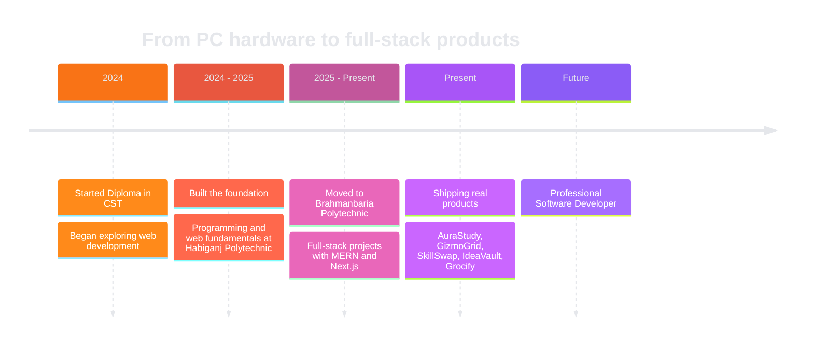

<!--
  PALETTE (matches portfolio):
  BG        = 0F0720   (deep violet-navy)
  CARD      = 1A0F2E
  ORANGE    = F97316   (primary accent)
  RED-ORNG  = FF5733   (gradient start)
  PURPLE    = A855F7   (gradient end / secondary)
  TEXT      = E5E7EB
-->

<!-- ═══════════════ HERO ═══════════════ -->
<div align="center">


<br/><br/>

<a href="https://himel-portfolio-brown.vercel.app/">
  
</a>

<br/>

<a href="mailto:s.b.himel21@gmail.com"></a>
<a href="https://drive.google.com/uc?export=download&id=1OzvaNrKqj6KnrErJawggpM-F28eIMqV4"></a>
<a href="https://himel-portfolio-brown.vercel.app/"></a>

<br/><br/>


</div>

<br/>

<!-- ═══════════════ ABOUT ═══════════════ -->
<h2 align="center">💫 About Me</h2>

<p align="center">
I'm a passionate <b>Full Stack Developer</b> and a <i>Diploma in Computer Science &amp; Technology</i> student at
<b>Brahmanbaria Polytechnic Institute</b> (5th Semester).<br/>
My journey started with a love for <b>PC hardware</b> and grew into building <b>scalable, user-friendly web apps</b>.<br/>
I believe great software is a blend of <b>technical precision</b> and <b>artistic vision</b>.
</p>

```js
const himel = {
  name: "S.B. Himel",
  role: "MERN Stack & Next.js Developer",
  location: "Brahmanbaria, Bangladesh 🇧🇩",
  education: "Diploma in CST — Brahmanbaria Polytechnic Institute (5th Sem)",
  stack: ["MongoDB", "Express", "React", "Next.js", "Node.js"],
  currentlyLearning: "Advanced Next.js patterns & Server Actions",
  alsoInto: ["PC optimization ⚙️", "Hardware tweaking 🛠️", "Poetry & Shayeri ✍️"],
  askMeAbout: ["MERN stack", "Next.js", "Auth & RBAC", "AI API integration"],
  funFact: "I debug code by day and write poems by night 🌙",
};
```

<br/>

<!-- ═══════════════ WHAT I BUILD ═══════════════ -->
<h2 align="center">⚡ What I Build</h2>

<table align="center">
  <tr>
    <td align="center" width="25%"><h3>🧩</h3><b>Full-Stack Web Apps</b><br/><sub>End-to-end products with React / Next.js frontends and Node + Express + MongoDB backends</sub></td>
    <td align="center" width="25%"><h3>🔐</h3><b>Auth &amp; Role Dashboards</b><br/><sub>JWT, Better Auth, protected routes and admin / user / seller workflows</sub></td>
    <td align="center" width="25%"><h3>🤖</h3><b>AI-Powered Features</b><br/><sub>Chat assistants and smart features wired into real products via AI APIs</sub></td>
    <td align="center" width="25%"><h3>🎨</h3><b>Responsive, Polished UI</b><br/><sub>Pixel-clean interfaces with Tailwind, HeroUI and smooth Framer Motion animation</sub></td>
  </tr>
</table>

<br/>

<!-- ═══════════════ CURRENT ═══════════════ -->
<h2 align="center">🚀 What I'm Up To</h2>

- 🛒 **Building** — [*Grocify*](https://grocify-client-three.vercel.app/), a farm-to-door grocery platform with 30-min delivery, COD & an AI shopping assistant
- 📚 **Exploring** — advanced **Next.js** features & **Server Actions**
- 🤖 **Experimenting** — AI API integration & prompt engineering inside real products
- 🏗️ **Working on** — dynamic, modern, and secure full-stack web applications
- 🎯 **Next goal** — landing my first role as a professional software developer

<br/>

<!-- ═══════════════ SKILLS ═══════════════ -->
<h2 align="center">🛠️ Tech Arsenal</h2>

<div align="center">

**Frontend**<br/>


**Backend & Database**<br/>


**Tools & Deployment**<br/>


<br/>


</div>

<br/>

<h3 align="center">📈 Skill Meter</h3>

<div align="center">

```text
HTML5        ████████████████████░  95%
CSS3         ██████████████████░░░  90%
Tailwind CSS ██████████████████░░░  90%
React.js     █████████████████░░░░  85%
MongoDB      ████████████████░░░░░  80%
JavaScript   ████████████████░░░░░  80%
Node/Express ███████████████░░░░░░  75%
Next.js      ██████████████░░░░░░░  70%  ← leveling up 🔥
```

</div>

<br/>

<!-- ═══════════════ PROJECTS ═══════════════ -->
<h2 align="center">📂 Featured Projects</h2>

<table>
  <tr>
    <td width="50%" valign="top">
      <a href="https://grocify-client-three.vercel.app/"></a>
      <h3>🛒 Grocify <sub>· latest</sub></h3>
      <p>Farm-to-door organic grocery platform — 8+ fresh aisles, 30-minute delivery, Cash on Delivery, auth, cart and an <b>AI shopping assistant</b>.</p>
      <p>   </p>
      <a href="https://grocify-client-three.vercel.app/"><b>🔗 Live</b></a> &nbsp;|&nbsp; <a href="https://github.com/SBHimel/grocify-client"><b>💻 Client</b></a> &nbsp;|&nbsp; <a href="https://github.com/SBHimel/grocify-server"><b>⚙️ Server</b></a>
    </td>
    <td width="50%" valign="top">
      <a href="https://aurastudy-rouge.vercel.app/"></a>
      <h3>🎓 AuraStudy</h3>
      <p>A modern Learning Management System giving students and instructors a structured, friendly learning experience.</p>
      <p>   </p>
      <a href="https://aurastudy-rouge.vercel.app/"><b>🔗 Live</b></a>
    </td>
  </tr>
  <tr>
    <td width="50%" valign="top">
      <a href="https://gizmogrid-kohl.vercel.app/"></a>
      <h3>⚡ GizmoGrid</h3>
      <p>Multi-role technology marketplace with separate workflows for buyers, sellers, managers and administrators.</p>
      <p>  </p>
      <a href="https://gizmogrid-kohl.vercel.app/"><b>🔗 Live</b></a>
    </td>
    <td width="50%" valign="top">
      <a href="https://skillswap-client-one.vercel.app/"></a>
      <h3>🤝 SkillSwap</h3>
      <p>Skill-sharing &amp; freelancing platform with role-based dashboards (client / freelancer / admin) and Better Auth.</p>
      <p>   </p>
      <a href="https://skillswap-client-one.vercel.app/"><b>🔗 Live</b></a> &nbsp;|&nbsp; <a href="https://github.com/SBHimel/skillswap-a10-client"><b>💻 Code</b></a>
    </td>
  </tr>
  <tr>
    <td width="50%" valign="top">
      <a href="https://ideavault-inky.vercel.app/"></a>
      <h3>💡 IdeaVault</h3>
      <p>Startup idea platform where users share, discover, search, filter and discuss ideas — with secure JWT auth.</p>
      <p>  </p>
      <a href="https://ideavault-inky.vercel.app/"><b>🔗 Live</b></a> &nbsp;|&nbsp; <a href="https://github.com/SBHimel/ideavault"><b>💻 Code</b></a>
    </td>
    <td width="50%" valign="top">
      <h3>📸 Pixen Studio</h3>
      <p>High-performance professional photography marketplace — service CRUD, secure auth and real-time reviews.</p>
      <p>  </p>
      <a href="https://pixen-studio.netlify.app/"><b>🔗 Live</b></a> &nbsp;|&nbsp; <a href="https://github.com/SBHimel/pixen"><b>💻 Code</b></a>
    </td>
  </tr>
</table>

<p align="center">
  <a href="https://himel-portfolio-brown.vercel.app/projects"></a>
</p>

<br/>

<!-- ═══════════════ JOURNEY ═══════════════ -->
<h2 align="center">🧭 My Journey</h2>



<br/>

<!-- ═══════════════ STATS ═══════════════ -->
<h2 align="center">📊 GitHub Stats</h2>

<div align="center">
  
  
  <br/>
  
  <br/>
  
  <br/><br/>
  
</div>

<br/>

<h3 align="center">🐍 Contribution Snake</h3>

<div align="center">
  <picture>
    <source media="(prefers-color-scheme: dark)" srcset="https://raw.githubusercontent.com/SBHimel/SBHimel/output/github-snake-dark.svg" />
    <source media="(prefers-color-scheme: light)" srcset="https://raw.githubusercontent.com/SBHimel/SBHimel/output/github-snake.svg" />
    
  </picture>
</div>

<br/>

<!-- ═══════════════ ACHIEVEMENTS ═══════════════ -->
<h2 align="center">🏆 Achievements &amp; Recognitions</h2>

<p align="center">
  
  
  
</p>

<p align="center"><sub>Programming Hero journey — selected based on core performance 💪</sub></p>

<br/>

<!-- ═══════════════ MORE ═══════════════ -->
<details>
<summary><b>🎲 More about me (click to expand)</b></summary>
<br/>

- ⚙️ I love PC optimization — squeezing out every bit of performance is my hobby
- ✍️ I write poetry & shayeri about life, philosophy and emotions
- 🧠 I learn best by building real projects, not just watching tutorials
- 🌱 Always leveling up — currently pushing Next.js from "intermediate" to "advanced"

</details>

<br/>

<!-- ═══════════════ PHILOSOPHY ═══════════════ -->
<h2 align="center">📜 A Slice of My Philosophy</h2>

<p align="center">
  <em>"Somman jodi onner, chintadhara jodi onner, tobe ami kisher ami?"</em><br/>
  <strong>"গল্পটা কাল্পনিক, প্রকাশ্যে আমি ভাসি, মৃত্যুটা নিশ্চিত, তা-ও অম্লতা দেখি।"</strong>
</p>

<br/>

<!-- ═══════════════ CONNECT ═══════════════ -->
<h2 align="center">🌐 Let's Work Together</h2>

<p align="center"><sub>Have a project, an internship or a collaboration in mind? My inbox is open.</sub></p>

<p align="center">
  <a href="https://himel-portfolio-brown.vercel.app/" target="_blank"></a>
  <a href="https://www.linkedin.com/in/sbhimel/" target="_blank"></a>
  <a href="https://x.com/himel2nd" target="_blank"></a>
  <a href="https://www.facebook.com/s.b.himel.669113" target="_blank"></a>
  <a href="mailto:s.b.himel21@gmail.com"></a>
</p>

<p align="center">
  
</p>


